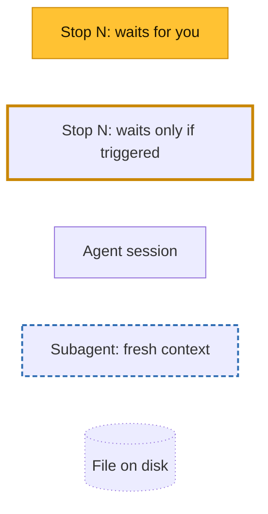
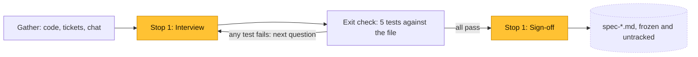
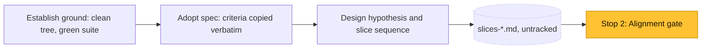
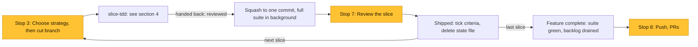
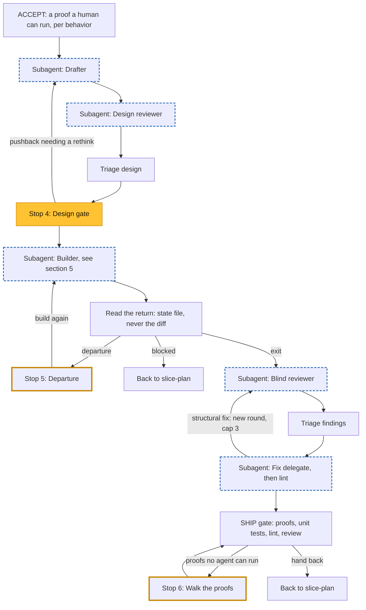
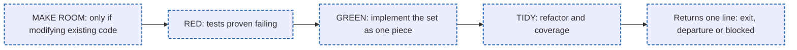

# Feature workflow

How a feature moves through `feature-spec`, `slice-plan` and `slice-tdd`, who acts at each step, and
where the work comes back to you. Each diagram zooms in on a step of the one before it. The skills
are the source of truth: if this page disagrees with a `SKILL.md`, the `SKILL.md` wins.

Three actors appear throughout: you, the agent session, and subagents, which are fresh agents with
their own context. Node labels name the actor where it isn't the session.

## 1. Spec: `feature-spec`

Once per feature, with no subagents.

## 2. Planning: `slice-plan`

Once per feature, with no subagents. Without a spec, `slice-plan` defines the feature and criteria
itself in place of adopting them.

## 3. Per-slice loop: `slice-plan`

The session is the host: it keeps the plan and owns the slice boundary.

Two paths aren't drawn:

- **Other strategies.** `direct`, `hand` and `navigator` build the slice in place of `slice-tdd`,
  then get a design review from a Slice reviewer subagent before the squash.
- **A blocked slice.** The host supplies what's missing, re-slices, or proposes an abandon, which
  needs your yes.

## 4. One slice: `slice-tdd`

One pass per slice. The session only triages and holds gates; subagents do the heavy steps, and each
one works from the state file, `slice-tdd-*.md`. `internal` mode skips ACCEPT and the design gate.

## 5. The TDD steps: BUILD

One Builder subagent runs all of this and never talks to you. Each phase re-reads the Rules in Force
header, and its closing commit records the next phase. In `yolo` mode, RED and GREEN become one
IMPLEMENT phase with no unit tests.

| Phase | What happens |
|---|---|
| MAKE ROOM | Pins untested code with `backfill-tests`, then does a behavior-preserving refactor. If it outgrows a few commits, the Builder returns `blocked` so it can become its own slice. |
| RED | Writes unit tests from the interface sketch against stubs that raise, and proves each test fails. A test that passes at once gets a mutation check. |
| GREEN | Implements the tests as one piece, running targeted tests only. Three flat runs means discard the attempt and go one test at a time. |
| TIDY | Refactors the whole slice diff, and treats any untested changed path as a finding. |

## Where you come in

| # | Stop | Skill | What you decide | How often |
|---|---|---|---|---|
| 1 | Interview and sign-off | `feature-spec` | What the behavior is and what is out of scope; your yes freezes the spec | Once per feature |
| 2 | Alignment gate | `slice-plan` | Criteria, hypothesis, slice order, the permanent slug | Once per feature |
| 3 | Choose strategy | `slice-plan` | Which strategy builds this slice; never carried over silently | Every slice |
| 4 | Design gate | `slice-tdd` | Direction and trade-offs; which acceptance proofs become suite tests | `acceptance` and `yolo` slices |
| 5 | Departure | `slice-tdd` | Whether the design changes, when the Builder or Fix delegate finds it can't hold | Only if triggered |
| 6 | Walk the proofs | `slice-tdd` | Run each acceptance proof no agent can run, and confirm what you see | Only proofs with no agent run |
| 7 | Review the slice | `slice-plan` | Accept, edit in place, reslice, reorder, or call the feature done | Every slice |
| 8 | Push, PRs | `slice-plan` | Whether and when the local branch stack gets published | End of feature |
| – | Abandon (not drawn) | `slice-plan` | Confirm an abandon, which restores the previous slice's tree | Only if proposed |

## Subagents

| Subagent | Spawned by | Job | What it sees |
|---|---|---|---|
| Drafter | `slice-tdd` | Researches and drafts the interface sketch and design doc | Behavior sentence, criteria, Constraints, acceptance tests |
| Design reviewer | `slice-tdd` | Reviews the draft; never the session that wrote it | The draft, and the code around the change |
| Builder | `slice-tdd` | MAKE ROOM, RED, GREEN, TIDY; returns one line | The state file and build instructions, nothing else |
| Blind reviewer | `slice-tdd` | Reviews the finished slice, up to 3 rounds | The diff and its tests, nothing of the plan |
| Fix delegate | `slice-tdd` | Applies triaged fixes and runs lint | The state file and fix instructions |
| Slice reviewer (not drawn) | `slice-plan` | Runs `design-review` at the boundary for `direct`, `hand` and `navigator` slices | The slice diff, by absolute repo path |
